<h1 align="center">Brim</h1>

<p align="center"><strong>Small touches. A better everyday.</strong></p>

<p align="center">The iPhone's Dynamic Island, made for the notch on your Mac.<br>Quiet until there's something to show.</p>

<p align="center">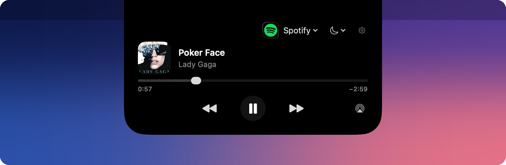</p>

Brim is a small native Mac app that lives around your camera. Music, timers, charging and AirPods appear beside the notch, the way they do on iPhone, and hovering opens them up. When nothing is happening, you won't know it's there.

It has no accounts and no cloud, and it asks for a permission only when a feature you turned on needs it.

## Around the notch

What's happening sits on either side of the camera, and it stays out of your way:

<p align="center"></p>

- **It stays out of the way.** Inside the app that's playing, the music steps aside, because you can already see it. Switch away and it comes back in the notch.
- **Colors from your music.** The playback bars take their color from the album art.
- **Swipe to hide.** Swipe an activity away with two fingers, and it stays hidden until something new happens.
- **Click to go there.** Click the music to jump to the app that's playing it. Hover to open the island instead.
- **It makes room for menus.** If a menu or status icon is under the activity, reaching for it makes the activity step aside.

Two things at once? The second one parts from the island into its own bubble, just like on iPhone:

<p align="center"></p>

## Open the island

Hover over the activity and it opens, only as tall as what's inside.

<table>
  <tr>
    <td width="50%">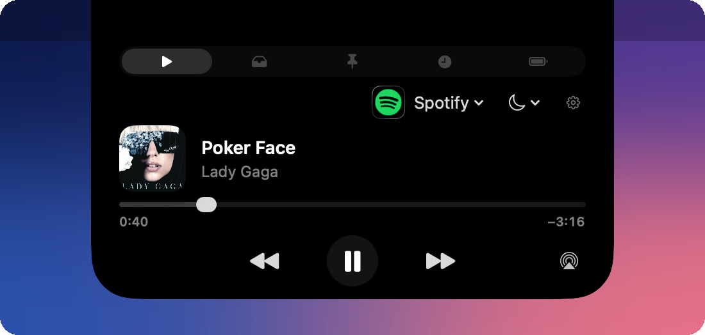</td>
    <td width="50%">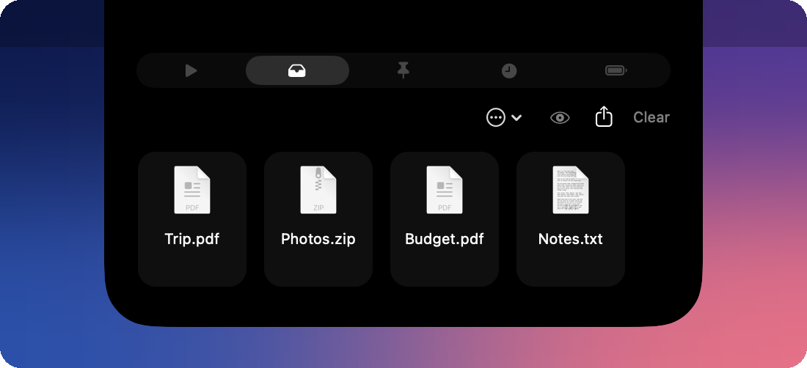</td>
  </tr>
  <tr>
    <td><strong>Now Playing</strong><br>Control Spotify, Music, or a video in your browser. Seek, choose where the sound plays, and set a sleep timer.</td>
    <td><strong>Files</strong><br>Drop files on the notch and drag them out anywhere later. They wait while you switch windows or Spaces.</td>
  </tr>
  <tr>
    <td>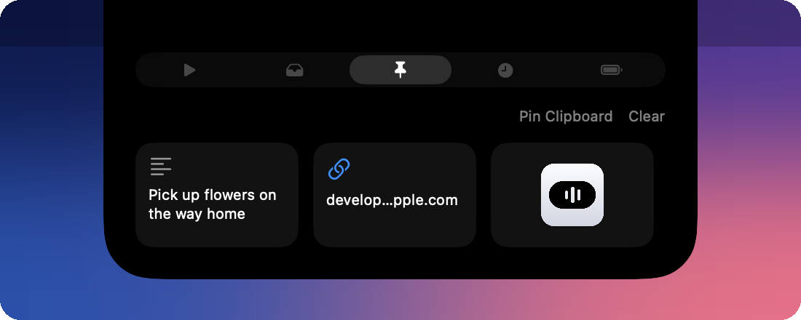</td>
    <td>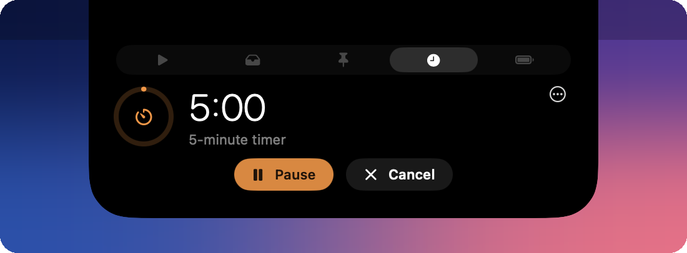</td>
  </tr>
  <tr>
    <td><strong>Clipboard</strong><br>Pin text, links and images, and click one to copy it again. Clipboard history is optional and stays in memory only.</td>
    <td><strong>Clock</strong><br>Timers, focus sessions, a stopwatch and alarms, one click from wherever you are.</td>
  </tr>
  <tr>
    <td>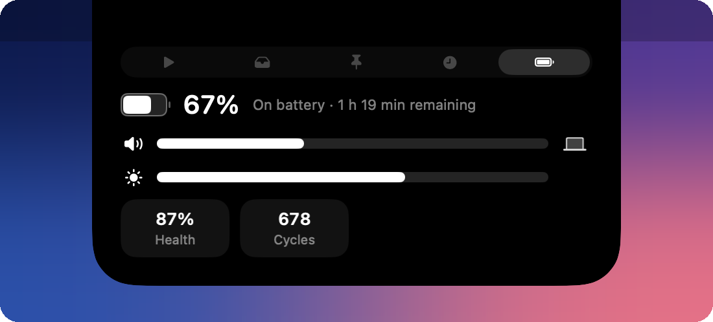</td>
    <td></td>
  </tr>
  <tr>
    <td><strong>Battery &amp; Controls</strong><br>Battery, time remaining, health, volume and brightness, all in one place.</td>
    <td><strong>Accessories</strong><br>Connect your AirPods and see every battery level at a glance.</td>
  </tr>
  <tr>
    <td>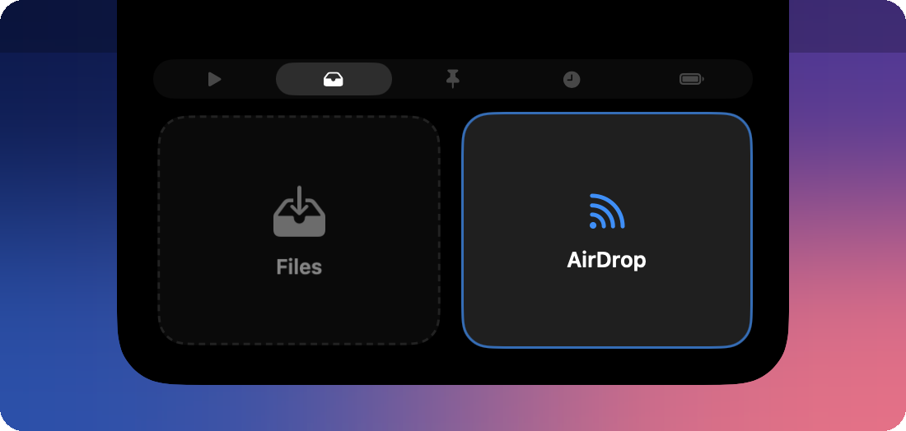</td>
    <td>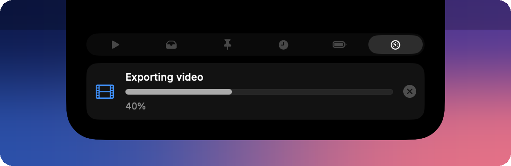</td>
  </tr>
  <tr>
    <td><strong>Drag to AirDrop</strong><br>Drag a file to the notch and choose where it goes: the shelf or AirDrop.</td>
    <td><strong>Your own activities</strong><br>Shortcuts and scripts can show their progress in the notch with a simple <code>brim://</code> link.</td>
  </tr>
</table>

## Choose how much it shows

A new install starts with **Essentials**, which does what the iPhone does and nothing more. Move up to **More** or **Everything** when you want the shelf, clipboard, clock and controls.

Anything that reads your calendar, downloads, screenshots or clipboard history, or needs a macOS permission, stays its own switch. Choosing a level never sets off a run of prompts.

<p align="center">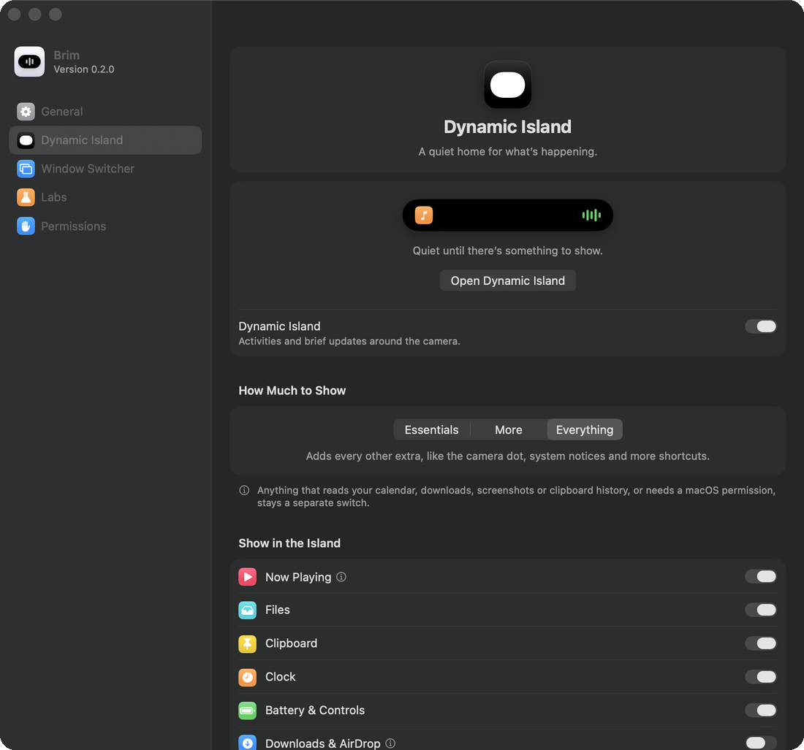</p>

## Window Switcher

Every window on ⌘Tab, not just every app. Hold, tab through, and let go. Search with `/`, and quit, close or hide right from the switcher. It's optional and off until you turn it on.

<p align="center">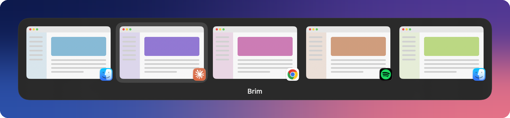</p>

## Labs

Two experiments that lean on your Mac's sensors. Fun, and a little unpredictable.

<table>
  <tr>
    <td width="62%">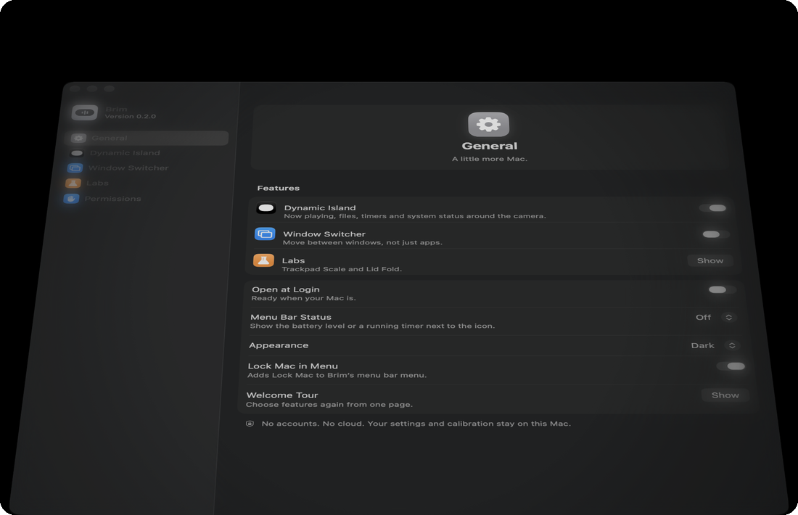</td>
    <td width="38%">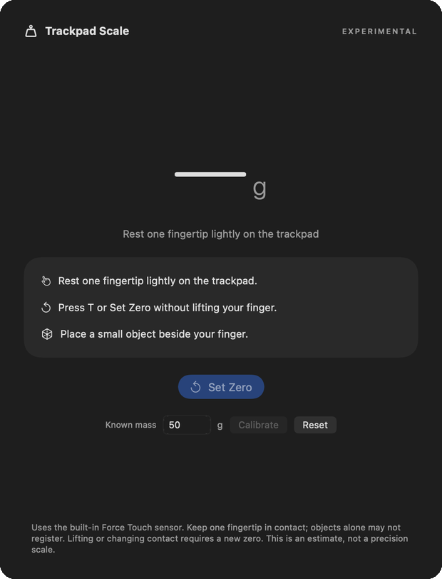</td>
  </tr>
  <tr>
    <td><strong>Lid Fold</strong><br>Your desktop follows the lid as you close your MacBook.</td>
    <td><strong>Trackpad Scale</strong><br>Weigh small objects on a Force Touch trackpad. An estimate, not a precision scale.</td>
  </tr>
</table>

## Get Brim

There's no download yet, so for now you build it yourself. It takes one command and needs only Apple's free Command Line Tools.

You need macOS 14 or later, and a Mac with a notch gets the most from it. Displays without a notch can show a floating island if you turn that on.

```sh
xcode-select --install
git clone https://github.com/jonasgandrup/Brim.git
cd Brim
./build.sh
open dist/Brim.app
```

Brim is available in English and Danish.

## More

- [How it works, and what its limits are](docs/TECHNICAL.md)
- [Third-party notices](THIRD_PARTY_NOTICES.md)

Now Playing and a few other features use private macOS interfaces, so they can stop working after a macOS update. When that happens they show as unavailable, and Brim never makes up a value.

<sub>Brim is an independent project, not affiliated with or endorsed by Apple or Spotify. Dynamic Island is Apple's name for its iPhone feature. Album art belongs to its owners and is shown only to illustrate the player. Screenshots are real captures of the app on a plain drawn backdrop. The files, clipboard pins, AirPods levels, export progress and window previews in them are samples.</sub>
